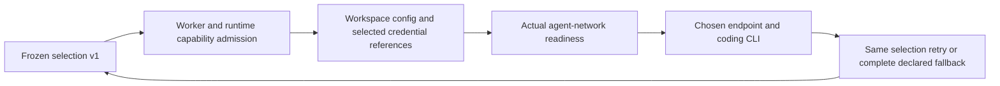
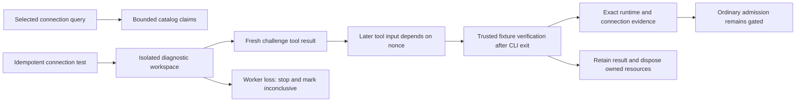

# Independent agent and model-provider selection

This release adds T4–T6 catalog and diagnostic workspaces to the merged T1–T3 foundation,
plus live monitor repair/restart identity preservation. Third-party
Codex/Claude admission defaults to disabled for new deployments through
`AWF_THIRD_PARTY_AGENT_PROVIDERS_ENABLED=false`. This foundation is deployable
before provider compatibility is established. Measured acceptance covers the
exact six tested selections below plus ordinary monitor repair/restart identity,
subject to the proof/opt-in gates documented here; it does not release general
third-party coding compatibility. No console interface is added.

## Selection contract

`task.agent` selects the coding CLI. Optional `task.provider` selects the model
service independently; `task.model` selects its exact model. Omitting provider
preserves native Codex/OpenAI and Claude/Anthropic defaults, including `xhigh`.
Cursor, Antigravity, Grok and OpenCode retain their existing selection behavior.
OpenCode continues using its qualified-model provider inference; this release
adds no OpenCode/OpenRouter parity feature.

Codex and Claude can describe `ollama` or `openrouter` selections. Such requests
require an explicit model and `preflight.allow_unverified_model=true` for models
without coding-compatibility evidence. That flag defaults to false. Known
embedding/reranking models fail even with experimental opt-in. Third-party
effort remains absent; explicit effort is rejected until supported evidence is
available. Native defaults cannot be reinstalled by the adapter registry.
Existing fallback `target.provider` is authoritative and each declared target
is frozen as a complete selection at creation.

The creation options are REST `task.provider` and
`preflight.allow_unverified_model`, CLI `workspace create --provider` and
`--allow-unverified-model`, and MCP `awf_create_workspace` parameters `provider`
and `allow_unverified_model`. Old requests remain valid. Adoption does not
accept new independent-provider fields.

`task_policy.agent_execution` freezes contract version **1**, agent, provider,
model, effort, explicitness, endpoint, credential reference, sidecar service
identity and compatibility status. New native selections are frozen too.
Rows without this field retain deliberate legacy inference. A present corrupt
or unknown snapshot fails with `EXECUTION_CONTRACT_UNSUPPORTED`; it never
falls through to native execution. The snapshot follows planning, execution,
repair, monitor reconstruction, restart/resume and recovery through existing
adapter defaults. Workspace, task, attempt and recovery projections expose it.
Unknown third-party pricing remains unknown; native profile prices are not
applied to another selection. Native usage collectors are not used to invent
third-party token/cost data.

## Connections and isolation

Both local Ollama models and `:cloud` models use the configured Ollama daemon.
AWF does not call `ollama.com` directly or copy the daemon's credential store
into an agent. URL precedence is profile before service environment; within
each source it is `AWF_OLLAMA_BASE_URL`, legacy
`AWF_OPENCODE_OLLAMA_BASE_URL`, then `OLLAMA_HOST`. Port defaults and Docker host
gateway normalization remain consistent with the legacy Ollama path. A single
normalized daemon origin preserves path prefixes and removes a trailing `/v1`.
Explicit malformed URLs, URL userinfo, query parameters and fragments are
rejected without echoing their contents.

OpenRouter has the fixed origin/prefix `https://openrouter.ai/api`: Codex uses
`/v1/responses`, Claude `/v1/messages`. Credentials use an
`env/OPENROUTER_API_KEY` reference, a profile environment alias, or an existing
declared env secret lease. Inline model-service credential values in expanded
runtime configuration are rejected. Snapshots, argv and hosted payloads contain
references, never credential values. Secret rotation behind the same reference
does not alter connection identity.

Auto-profile requests defer endpoint, credential-reference and network-service
snapshots until provisioning resolves the repository profile. The primary and
all declared fallbacks bind together and commit atomically with the resolved
profile before stack launch, under the existing port-admission and claim locks.
Worker loss before that commit leaves both unbound. Afterward, credential
rehydration rejects changed repository profiles or credential aliases with
`EXECUTION_PROFILE_CHANGED`; unchanged profiles retain the frozen connection even
if worker defaults change. A competing resolver stops without replacing or
failing the winning binding.
Native selections carry a pending-default marker until the executor freezes its
configured model/effort defaults; explicit request fields win, and restarts keep
the authoritative values. Initial feature/release sync monitors freeze before
their first adapter, preserving that selection through restart. OpenCode derives
its provider from the effective model and rejects a configured model that
conflicts with an explicit provider constraint. Host-local endpoint normalization
reuses the existing IPv4 loopback, expanded IPv6, mapped IPv4 and
unspecified-address policy.

Third-party stacks suppress native auth mounts and competing model-service env,
including Claude backend toggles and role-model variables. Native selections
retain their own backend configuration and auth while omitting fallback-provider
material. Ollama stacks omit
OpenRouter credentials from ambient auth, profile env and declared leases before
rendering the container environment. OpenRouter materialization and execution
passthrough use the frozen credential reference; separate tool auth is retained.
The declared auth resolver copies only allowed instruction/tool configuration
into a workspace owned, read-only source file under the existing `auth/<workspace>` cleanup
root. Source auth/config is unchanged. A standalone stdlib runner in the pinned
agent image creates a distinct config for each invocation under the invoking
user's home at `~/.awf/provider-config` (`/home/agent/.awf/provider-config` in the
standard agent container), outside OS temporary storage. It injects only the
selected model credential and removes the config after completion, failure or
TERM cancellation. Codex uses a custom Responses provider and an
untrusted project-config layer; Claude disables inherited setting sources.
Safe instructions and allowed tool/permission configuration remain available.
The runner scrubs the selected credential before forwarding stdout/stderr.
Hard-killed containers remain subject to AWF's ordinary container cleanup.

Monitor resume resolves the promoted selection's actual auth mounts and provider
environment before recreating the agent. This covers native/third-party changes
and Ollama/OpenRouter changes across both supported agents. Fallback credentials
are not preloaded. Companion services, database values and Compose interpolation
remain intact; materialization failures stop the resume with a durable reason.

The runtime probes the selected endpoint/model from its own network before each
invocation. Readiness is separate from coding compatibility. Creation records
`EXECUTION_NETWORK_PROBE_PENDING` and defers that network observation; a host
request never certifies a future sidecar. Enabled ordinary admission requires
exact successful diagnostic evidence or `preflight.allow_unverified_model=true`.
Auto-profile evidence lookup waits for atomic connection binding. The exact
image ID, CLI version, model revision when available, selection, connection scope
and fixture version are checked again before each proof-authorized invocation,
including monitor repairs. Explicit experimental opt-in still requires runtime
isolation and endpoint readiness. Admission remains disabled by default.

Unknown runtime images fail with `EXECUTION_RUNTIME_CONTRACT_UNSUPPORTED` before
a coding CLI launches. Managed provider configuration and project Claude agent
definitions that cannot be isolated are explicitly unsupported. Custom auth
resolvers lacking safe-config preparation fail explicitly. Hosted request
serialization carries the complete selection; injected executors must advertise
`execution_contract_version=1` and enforce equivalent isolation. The built-in
hosted delegate does not advertise that guarantee and rejects expanded work;
native hosted behavior remains available.

## Recovery and cooldown scope

Migration **85ce3f9b2a61** follows **c6d7e8f9a0b1**. It preserves existing
cooldown history in the fixed `legacy` scope and replaces pair uniqueness with
`(provider, model, connection_scope)`. The scope hashes normalized endpoint and
credential-reference identity. Independent sidecars additionally use service
and workspace namespace; a new attempt binds to its own namespace. Shared
remote servers retain shared scope. No secret values or token hashes enter the
key. Scheduler, capacity and monitor suppression share one resolver and retain
batched candidate queries. Concurrent failure increments serialize per scope.

Same-choice retry retains the entire selected snapshot. Explicit fallback
promotes the target's entire snapshot for both a new attempt and an in-place
monitor repair, clearing incompatible effort and Cursor Auto selection. An
approved planning-scope model fallback also updates the frozen selection used by
executor helpers and adapter reconstruction, preserving provider, endpoint,
credential reference and native effort. OpenCode model promotion recomputes its
provider and honors an explicit provider constraint. New third-party primaries and declared fallbacks remain blocked while admission
is disabled. Enabled selections reach the actual runtime-network probe. An uncontracted third-party fallback is
rejected. Cross-choice native fallback is never inferred for a third-party
selection. Disabling admission blocks new
third-party fallback promotions as well as creation; already selected work
retains its identity while draining or parked.

Schema/execution-v1 rollback floor: **`8322f8c33eec252d86a1ee5e95f5f313111abd9f`**
(merged repaired foundation, PR #1199). Once diagnostic rows exist, the operational
rollback floor is **`99bf2d1f049ef87f78271568ed65c675d523b5ee`** (fully repaired
merged feature, T4–T6, worker capability 2, fixture v1). The foundation alone
cannot resume live diagnostics.

Workers in this release advertise capability **2** (execution selection remains v1). Expanded admissions require every live queue consumer at capability 2; legacy rows backfill to
**0**, meaning unsupported. Admission requires every live queue consumer to be
compatible, and dispatch rechecks capability. This metadata cannot make an
already-running old binary safe. Follow the mandatory [upgrade and rollback
sequence](UPGRADE.md#provider-foundation-compatibility-floor).

## Discovery and connection tests

| Intent | REST | CLI | MCP |
| --- | --- | --- | --- |
| Catalog claims | `POST /v1/providers/models/query` | `awf provider models` | `awf_query_provider_models` |
| Coding diagnostic | `POST /v1/providers/connection-tests` | `awf provider test` | `awf_test_provider_connection` |

Both accept `agent`, `provider`, optional `profile_ref` or inline `profile`.
Diagnostics additionally require `model`; `effort` follows normal compatibility
rules. Native catalog discovery is explicitly unsupported. Ollama uses only the
configured daemon's `/api/tags`; OpenRouter uses its official `/api/v1/models`.
Discovery never pulls models or invokes an agent. HTTP is bounded to 10 seconds,
2 MB and 5,000 items, with redirects refused. A bounded 128-entry, five-minute
cache uses connection/credential-reference and agent/profile context. No token
values or token hashes identify cache entries. Model capabilities/pricing are
provider claims, nullable when absent. Discovery failure retains manual entry;
it supplies no coding-compatibility proof. Sidecar catalog discovery explicitly
returns `PROVIDER_DISCOVERY_NETWORK_UNSUPPORTED` because no disposable discovery
network transport is available.

Connection tests require `Idempotency-Key` (MCP/CLI `idempotency_key`). Identical
requests return the same workspace/operation; changed diagnostic identity,
profile, deadline or configured runtime returns `IDEMPOTENCY_CONFLICT`. Deadlines
default to 180 seconds, maximum 900. A test request authorizes its candidate
model while ordinary admission is disabled; no second experimental flag is needed.
Known incompatible agent/model/effort combinations still fail.

Diagnostics use normal queue capacity, claims, operations, logs and cleanup.
They branch before project checkout/hooks, forge access, planning, phases,
validation commands and PR lifecycle. The repository identity
`awf-internal://provider-diagnostic/v1` is solely an internal managed linked
fixture worktree. Selected model sidecars may be reproduced only without builds,
project binds, volumes, fixed ports, privilege, dependencies or secret env.
Unsupported profiles fail explicitly; no replacement host endpoint is chosen.
The internal mirror is mounted read-only; no diagnostic commits are needed.
Before creating a new fixture worktree, bootstrap repairs an empty internal
mirror or a missing fixture ref under the mirror lock. Existing refs and
workspaces are preserved; this repair never replays a diagnostic invocation.
Forge/SSH/git auth and unrelated model settings are omitted. Native diagnostics
receive only selected native credential references and isolated credential-only
writable homes for CLI state/refresh, without inherited model/tool config; third-party
invocation homes remain outside OS temporary directories.

The `coding-cycle-v1` fixture asks for one pure function using a fresh challenge
nonce. The immutable challenge/verifier live under `/opt/awf`, outside writable
files. Runtime admission requires a nonroot CLI user and root-owned, unwritable
oracle/interpreter paths. Python wrappers use the pinned absolute interpreter
with isolated startup, so user-site code cannot replace the verifier. The verifier permits literal constants, a pure `answer(value)` function,
concatenation/f-strings and reverse slicing; imports, calls and executable module
statements fail. This keeps candidate code from replacing the oracle or forging
its output. A pass requires ordered, completed top-level typed CLI events with
distinct call IDs: challenge result first, then a tool input containing its exact
nonce. Nested JSON in tool output, prose, exit zero, a combined challenge/edit
command, missing/truncated output, or edited tests cannot establish a pass.
AWF independently verifies the fixture after CLI termination.

Read the workspace's `task_policy.provider_diagnostic`, operation result, events
and existing log surfaces. Results distinguish endpoint health, protocol witness,
fixture verification, a bounded four-event ordered witness with call IDs and nonce-dependent input excerpt, exact selection/model revision, CLI version and actual
runtime image ID. Unknown upstream revisions remain null. Results survive
fixture disposal. Cancel/stop/destroy terminate the runtime before disposal,
including cancel with `stop_stack=false`; teardown failure retains the fixture.
Ordinary retry/refresh/validate/rebase/remonitor/guide controls are rejected.
The durable invocation-start marker prevents paid replay after worker loss:
recovery fences the old owner, stops its runtime and records inconclusive.
AWF never retries diagnostic invocations, falls back, pushes or opens PRs.

## Remaining release gates and preliminary evidence

Deployed-AWF coding compatibility is now measured for exactly the six tested
selections below plus monitor repair/restart identity: all six deployed diagnostics
in the pinned runtime
(`sha256:8e0f082a466be412010ec9f17f7ee5622903b229760b68507076aef844d4b04d`)
passed with reason `PROVIDER_DIAGNOSTIC_PASSED`, verified fixture
`coding-cycle-v1` and passed protocol evidence (supervisor evidence captured
2026-11-10T02:57:05Z). Live monitor repair/restart identity dogfood was then
performed on this PR: the worker was restarted while the monitor was idle, the
workspace identity and connection scope were preserved, and the subsequent
repair invocation re-selected the same Codex/OpenRouter/`moonshotai/kimi-k2.7-code`
contract (supervisor evidence captured 2026-11-10T03:07:44Z). Local Ollama is implemented and covered deterministically,
**not live-verified**, and excluded from the live release gate by explicit
operator instruction. Do not invoke local inference or change the unrelated
host llama-server.

These measured passes cover only the exact agent/provider/model selections
listed; they do not establish that all provider-catalog models are
coding-compatible. Selection stays explicit through REST `task.provider`/
`task.model`, CLI `workspace create --provider`/`--model`, and MCP
`awf_create_workspace` parameters. Omitting provider preserves the native
Codex/OpenAI and Claude/Anthropic defaults. Any other model still requires
exact successful diagnostic evidence or `preflight.allow_unverified_model=true`;
that experimental opt-in does not imply general catalog support.

| Path | Preliminary CLI-only observation | Deployed AWF acceptance |
| --- | --- | --- |
| Codex / Ollama cloud daemon / `kimi-k2.7-code:cloud` | Dependent tools and fixture observed; return-code metadata missing | **Passed** — codex-cli 0.162.0, `PROVIDER_DIAGNOSTIC_PASSED`, fixture `coding-cycle-v1`, model revision `eda07a6592375dcbde7cf167b6d6b368cdd28e244f9d71559fb59919aca882fa`, evidence workspace `ws_3c4b15e47f034356973a527f`, connection scope `1098d60c…362f` |
| Claude / Ollama cloud daemon / `kimi-k2.7-code:cloud` | Dependent tools and fixture observed | **Passed** — Claude Code 2.1.295, `PROVIDER_DIAGNOSTIC_PASSED`, fixture `coding-cycle-v1`, model revision `eda07a6592375dcbde7cf167b6d6b368cdd28e244f9d71559fb59919aca882fa`, evidence workspace `ws_286649acb2d04a29a3301ed8`, connection scope `1098d60c…362f` |
| Codex / OpenRouter / `moonshotai/kimi-k2.7-code` | Dependent tools and fixture observed | **Passed** — codex-cli 0.162.0, `PROVIDER_DIAGNOSTIC_PASSED`, fixture `coding-cycle-v1`, no upstream revision pinned, evidence workspace `ws_e13cf39dd6f8484ba824e423`, connection scope `c24e8d23…7fa3` |
| Claude / OpenRouter / `minimax/minimax-m2.7` | Dependent tools and fixture observed | **Passed** — Claude Code 2.1.295, `PROVIDER_DIAGNOSTIC_PASSED`, fixture `coding-cycle-v1`, no upstream revision pinned, evidence workspace `ws_d3b54742506044039b37b9ca`, connection scope `c24e8d23…7fa3` |
| Codex native | CLI 0.162.0 observed | **Passed** — codex-cli 0.162.0 / `gpt-6.1-sol`, `PROVIDER_DIAGNOSTIC_PASSED`, fixture `coding-cycle-v1`, no upstream revision pinned, evidence workspace `ws_ef1c0b2d51894d8bb2c81af9`, legacy scope |
| Claude native | CLI 2.1.295 observed | **Passed** — Claude Code 2.1.295 / `claude-opus-5-5`, `PROVIDER_DIAGNOSTIC_PASSED`, fixture `coding-cycle-v1`, no upstream revision pinned, evidence workspace `ws_c45f6f1c738e4cb59fb1349c`, legacy scope |
| Monitor repair/restart identity | Live supervisor dogfood | **Passed** — worker restarted while monitor idled on `WaitForCI` (iter 0, head `1922c8634dcbf2fb05ac9761dd25a725e60f91dc`), no active CLI confirmed (`True`); workspace `ws_b8779b060a6d4e2da857074b` identity unchanged (`True`) and connection scope `c24e8d23…7fa3` preserved. Repair invocation at `2026-11-10T03:07:44.986923+00:00` re-selected Codex/OpenRouter/`moonshotai/kimi-k2.7-code` with `effort=null`, endpoint `https://openrouter.ai/api`, credential ref `env/OPENROUTER_API_KEY`, runtime `sha256:8e0f082a466be412010ec9f17f7ee5622903b229760b68507076aef844d4b04d` |

The Codex/OpenRouter Minimax preliminary attempt regenerated its nonce and failed
the fixture. Its transcript remains a negative regression; like every
preliminary observation above, it is a non-deployed CLI-only record, distinct
from the deployed AWF passes and not evidence of deployed acceptance. Source runtime pins
and locally observed versions are Codex **0.162.0**, Claude **2.1.295**; these do
not identify a deployed image. Sanitized preliminary envelopes are deterministic
parser fixtures, never live AWF passes. The supervisor-provided preliminary image
was `sha256:c7d73ed4150e2e1c274e9b90b3b128e6f35a90537ada7033d62a3f07cbc5f39e`,
with wrapper commit `526823f0842009f1abadbc8965ddb0dfcf1939a8`; this is not a
deployed diagnostic-runtime identity. OpenRouter credentials are configured
and `/api/v1/key` was reported authenticated (HTTP 200); this is auth health only.
Cloud descriptor/catalog IDs cannot establish immutable upstream model weights.

AWF/GitHub own broad validation and the authoritative 99% coverage gate. Focused
checks and unmet release evidence are recorded in ignored local validation plans.

Provider configuration references: [Codex advanced configuration](https://developers.openai.com/codex/config-advanced/),
[Ollama Claude integration](https://docs.ollama.com/integrations/claude-code),
[OpenRouter Codex](https://openrouter.ai/docs/cookbook/coding-agents/codex-cli),
[OpenRouter Claude](https://openrouter.ai/docs/cookbook/coding-agents/claude-code-integration),
and [Claude settings](https://code.claude.com/docs/en/settings).

## PR 1199 regression repairs

Local service Compose forwards `OPENROUTER_API_KEY` and `AWF_OLLAMA_BASE_URL`
to both API and worker, using empty defaults. Declared AWS/Google tool settings
(such as regions, profiles and application credentials) survive provider
isolation; model-backend overrides and role settings are still removed.

The runtime bounds pipe draining after CLI exit and terminates the CLI process
group on completion or cancellation, including inherited writers that ignore
TERM. Temporary invocation configuration is removed after shutdown.

A corrupt or unknown execution snapshot fails only its workspace during
scheduling, with a version fence protecting a concurrently repaired row.
Capacity excludes that row; list/show/overview expose
`agent_execution.reason_code=EXECUTION_CONTRACT_UNSUPPORTED` with unavailable
identity and pricing, without inferring a native selection.

Native hosted monitor resume works without Compose. Expanded hosted selection
without materialization remains rejected. Existing Compose refresh replaces the
selected environment and mounts before recreation. OpenCode configured defaults
and recovery models keep their provider/model pair coherent.

Profiles with host ports defer binding/publication until preflight and companion
checks finish, then freeze the profile and execution snapshots in the existing
locked admission transaction. Port-free profiles retain early atomic binding
for worker-replacement safety.

Focused regressions cover these repairs. Full validation, coverage, review
replies, push and merge remain owned by AWF/GitHub. The six deployed compatibility passes and the live monitor repair/restart identity proof are recorded above.
