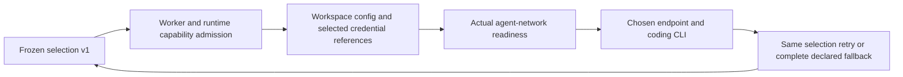

# Independent agent and model-provider selection: foundation

This release implements T1–T3 of the approved provider plan. Third-party
Codex/Claude admission defaults to disabled through
`AWF_THIRD_PARTY_AGENT_PROVIDERS_ENABLED=false`. This foundation is deployable
before provider compatibility is established; it does not release third-party
coding compatibility. No console interface is added.

## Selection contract

`task.agent` selects the coding CLI. Optional `task.provider` selects the model
service independently; `task.model` selects its exact model. Omitting provider
preserves native Codex/OpenAI and Claude/Anthropic defaults, including `xhigh`.
Cursor, Antigravity, Grok and OpenCode retain their existing selection behavior.
OpenCode continues using its qualified-model provider inference; this release
adds no OpenCode/OpenRouter parity feature.

Codex and Claude can describe `ollama` or `openrouter` selections. Such requests
require an explicit model and `preflight.allow_unverified_model=true` for models
without coding-compatibility evidence. That flag defaults to false. Known
embedding/reranking models fail even with experimental opt-in. Third-party
effort remains absent; explicit effort is rejected until supported evidence is
available. Native defaults cannot be reinstalled by the adapter registry.
Existing fallback `target.provider` is authoritative and each declared target
is frozen as a complete selection at creation.

The creation options are REST `task.provider` and
`preflight.allow_unverified_model`, CLI `workspace create --provider` and
`--allow-unverified-model`, and MCP `awf_create_workspace` parameters `provider`
and `allow_unverified_model`. Old requests remain valid. Adoption does not
accept new independent-provider fields.

`task_policy.agent_execution` freezes contract version **1**, agent, provider,
model, effort, explicitness, endpoint, credential reference, sidecar service
identity and compatibility status. New native selections are frozen too.
Rows without this field retain deliberate legacy inference. A present corrupt
or unknown snapshot fails with `EXECUTION_CONTRACT_UNSUPPORTED`; it never
falls through to native execution. The snapshot follows planning, execution,
repair, monitor reconstruction, restart/resume and recovery through existing
adapter defaults. Workspace, task, attempt and recovery projections expose it.
Unknown third-party pricing remains unknown; native profile prices are not
applied to another selection. Native usage collectors are not used to invent
third-party token/cost data.

## Connections and isolation

Both local Ollama models and `:cloud` models use the configured Ollama daemon.
AWF does not call `ollama.com` directly or copy the daemon's credential store
into an agent. URL precedence is profile before service environment; within
each source it is `AWF_OLLAMA_BASE_URL`, legacy
`AWF_OPENCODE_OLLAMA_BASE_URL`, then `OLLAMA_HOST`. Port defaults and Docker host
gateway normalization remain consistent with the legacy Ollama path. A single
normalized daemon origin preserves path prefixes and removes a trailing `/v1`.
Explicit malformed URLs, URL userinfo, query parameters and fragments are
rejected without echoing their contents.

OpenRouter has the fixed origin/prefix `https://openrouter.ai/api`: Codex uses
`/v1/responses`, Claude `/v1/messages`. Credentials use an
`env/OPENROUTER_API_KEY` reference, a profile environment alias, or an existing
declared env secret lease. Inline model-service credential values in expanded
runtime configuration are rejected. Snapshots, argv and hosted payloads contain
references, never credential values. Secret rotation behind the same reference
does not alter connection identity.

Local stacks suppress native auth mounts and competing model-service env,
including Claude backend toggles and role-model variables. The declared auth
resolver copies only allowed instruction/tool configuration into a workspace
owned, read-only source file under the existing `auth/<workspace>` cleanup
root. Source auth/config is unchanged. A standalone stdlib runner in the pinned
agent image creates a distinct temporary config for each invocation, injects
only the selected model credential, and removes that config after completion,
failure or TERM cancellation. Codex uses a custom Responses provider and an
untrusted project-config layer; Claude disables inherited setting sources.
Safe instructions and allowed tool/permission configuration remain available.
The runner scrubs the selected credential before forwarding stdout/stderr.
Hard-killed containers remain subject to AWF's ordinary container cleanup.

The runtime performs bounded (10-second), redirect-disabled checks of the
selected endpoint/model from its own network. Readiness is not coding
compatibility. Foundation creation cannot certify the actual future agent
network and explicitly returns `EXECUTION_NETWORK_PROBE_UNSUPPORTED`, including
for sidecar-only endpoints. Readiness overrides cannot bypass this rejection.
Consequently enabling the feature flag alone does not open these paths in this
foundation. T4–T6 must complete admission-network verification and release gates.

Unknown runtime images fail with `EXECUTION_RUNTIME_CONTRACT_UNSUPPORTED` before
a coding CLI launches. Managed provider configuration and project Claude agent
definitions that cannot be isolated are explicitly unsupported. Custom auth
resolvers lacking safe-config preparation fail explicitly. Hosted request
serialization carries the complete selection; injected executors must advertise
`execution_contract_version=1` and enforce equivalent isolation. The built-in
hosted delegate does not advertise that guarantee and rejects expanded work;
native hosted behavior remains available.

## Recovery and cooldown scope

Migration **85ce3f9b2a61** follows **c6d7e8f9a0b1**. It preserves existing
cooldown history in the fixed `legacy` scope and replaces pair uniqueness with
`(provider, model, connection_scope)`. The scope hashes normalized endpoint and
credential-reference identity. Independent sidecars additionally use service
and workspace namespace; a new attempt binds to its own namespace. Shared
remote servers retain shared scope. No secret values or token hashes enter the
key. Scheduler, capacity and monitor suppression share one resolver and retain
batched candidate queries. Concurrent failure increments serialize per scope.

Same-choice retry retains the entire selected snapshot. Explicit fallback
promotes the target's entire snapshot for both a new attempt and an in-place
monitor repair, clearing incompatible effort and Cursor Auto selection. An
uncontracted third-party fallback is rejected. Cross-choice native fallback is
never inferred for a third-party selection. Disabling admission blocks new
third-party fallback promotions as well as creation; already selected work
retains its identity while draining or parked.

Oldest compatible rollback code: **`09793d89fcd27cac2cdbcf2aa6777c703a8c4570`**.

Worker heartbeats advertise execution contract **1**; legacy rows backfill to
**0**, meaning unsupported. Admission requires every live queue consumer to be
compatible, and dispatch rechecks capability. This metadata cannot make an
already-running old binary safe. Follow the mandatory [upgrade and rollback
sequence](UPGRADE.md#provider-foundation-compatibility-floor).

## Remaining release gates and preliminary evidence

R6 (catalog REST/CLI/MCP query and bounded cache) is pending T4. R7–R8 (diagnostic
workspaces, two dependent tool turns, typed evidence, cancellation/idempotency,
worker-loss/no-paid-replay and lifecycle cleanup) are pending T5. R9 (full pinned
matrix and real repair/restart monitor dogfood) is pending T6. No model discovery
or connection-test API/CLI/MCP surface is claimed by this foundation.

The bounded preliminary check on 2026-11-09 observed installed **Codex 0.162.0**
and **Claude Code 2.1.295**, matching source image pins. The first probe appended
daemon paths to the configured protocol URL, retaining `/v1`, and received HTTP
errors. Correcting that probe to the normalized origin returned **Ollama
0.33.3** and its model tags from the actual AWF agent container. The secret-free
endpoint fingerprint was
`9d1b16df9590a408ee23ac4a310c9a0caab3b2990c7ab894fea107b1cdf2c344`.
Docker's server/image digest was unavailable. Host provider auth/config was not
changed or inspected for keys. Each CLI attempt used a disposable fixture,
isolated home/config, no forge/native credentials, and a 12-second deadline.

Local tag `qwen3.8:latest` had digest
`22130167c4c20e20c7b71454612966ca8e8171e9b3cc8ab6ce8aa6cbfec79643`.
Cloud-through-daemon tag `kimi-k2.7-code:cloud` had local descriptor digest
`eda07a6592375dcbde7cf167b6d6b368cdd28e244f9d71559fb59919aca882fa`;
this descriptor does not establish an immutable upstream cloud model version.
An initial evidence parser failed on a string-valued CLI `message`; those
attempts are inconclusive and cloud calls were not replayed. Corrected local
parsing retained ordered event types only, without raw model output.

| Release path | Preliminary disposition | Coding-cycle/tool evidence |
| --- | --- | --- |
| Codex → Ollama local (`qwen3.8:latest`) | Exit 1 | `thread.started`, `item.completed(error)`, `turn.started`, `error`, `turn.failed`; no tool events or verified fixture |
| Codex → Ollama cloud through daemon (`kimi-k2.7-code:cloud`) | Attempted; evidence parser failed | Inconclusive; no retained tool evidence or pass |
| Claude → Ollama local (`qwen3.8:latest`) | 12-second deadline; TERM exit 143 | Five `system` events; no tool events or verified fixture |
| Claude → Ollama cloud through daemon (`kimi-k2.7-code:cloud`) | Attempted; evidence parser failed | Inconclusive; no retained tool evidence or pass |
| Codex → OpenRouter | Operator reports key unavailable | None; pending |
| Claude → OpenRouter | Operator reports key unavailable | None; pending |
| Codex native baseline | Installed CLI version recorded; deterministic native regression tests | Live baseline pending |
| Claude native baseline | Installed CLI version recorded; deterministic native regression tests | Live baseline pending |

Focused tests exercise real rendered files, synthetic credential redaction,
standalone CLI protocol fixtures, runtime cancellation, HTTP failures/redirects,
Postgres migration/concurrency, persisted recovery, registry defaults and
scheduler/capacity parity. They are not live coding-compatibility passes. AWF
and GitHub own the full suite and authoritative **99%** coverage gate; this
workspace does not run or lower that gate.

Provider configuration references: [Codex advanced configuration](https://developers.openai.com/codex/config-advanced/),
[Ollama Claude integration](https://docs.ollama.com/integrations/claude-code),
[OpenRouter Codex](https://openrouter.ai/docs/cookbook/coding-agents/codex-cli),
[OpenRouter Claude](https://openrouter.ai/docs/cookbook/coding-agents/claude-code-integration),
and [Claude settings](https://code.claude.com/docs/en/settings).
